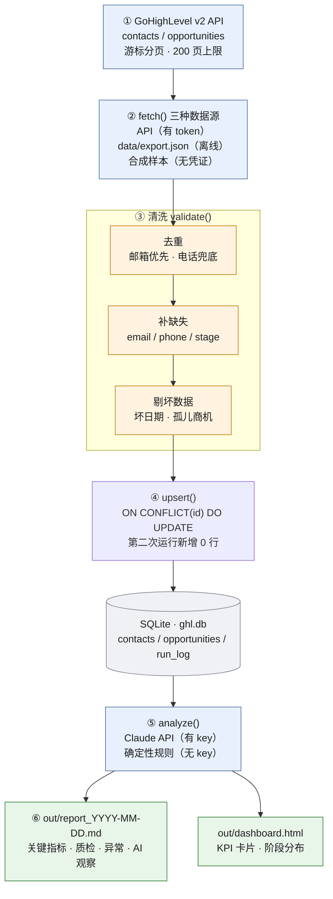

# 管道流程图

同一张图的两种形态：

- `pipeline_flow.png` — 中文版，可直接贴进提案或文档
- 下面的 Mermaid 源码 — GitHub / Notion / Obsidian 可直接渲染

## Mermaid

## 每个方框对应代码里的哪一段

| 图上的方框 | 代码位置 |
|---|---|
| ① API / ② 数据源 | `fetch_from_ghl()` / `fetch_from_export()` / `fetch_synthetic()` |
| ③ 清洗 | `validate()` |
| ④ 幂等入库 | `upsert()` |
| ⑤ 分析 | `analyze()` |
| ⑥ 输出 | `build_report()` / `build_dashboard()` |

## 三个方框是这张图的重点

**③ 清洗** —— 决定报告能不能用。没有这一步，下面的数字是错的。

**④ 幂等** —— 决定这个管道能不能无人值守地跑。没有这一步，重试就会写重。

**⑤ 降级** —— 决定它在依赖失败时会不会停。没有这一步，模型 API 一挂，当天就没有报告。

其余都是搬砖。
